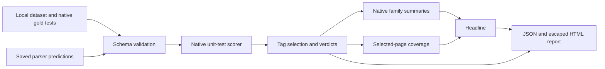

# OCR Slice Benchmark

Compare **saved OCR predictions** using deterministic, explainable unit tests. Inspect failures by document type instead of selecting a parser from one average score. The application calls the real [Omni Parse Bench](https://github.com/datalab-to/omni_parse_bench) scorer for text presence, reading order, repetition, table relationships and layout labels. No LLM judges the output.

The bundled dataset contains **three synthetic documents and twelve checks**. All three parser outputs are simulated fixtures; their names, scores and failures are not measurements of DeepSeek-OCR, PaddleOCR-VL, Surya or any real model. This project evaluates supplied predictions; it does not extract text from images or run an OCR engine.

## Run

Use Python 3.12 or newer and Git. In PowerShell:

```powershell
python -m venv .venv
.venv\Scripts\python -m pip install -r requirements.txt
.venv\Scripts\python -m ocr_slices --json reports/all.json --html reports/all.html
.venv\Scripts\python -m ocr_slices --tag handwriting --json reports/handwriting.json --html reports/handwriting.html
.venv\Scripts\python -m unittest discover -s tests -v
```

On macOS/Linux, substitute `.venv/bin/python` for `.venv\Scripts\python`. Open the generated HTML in a browser. It is self-contained and makes no network requests. Installing dependencies requires network access; grading afterward runs offline and needs no API keys or model weights.

The complete fixture passes 12/12 checks with headline 1.0. The table-focused fixture passes 6/12, with headline about 0.6806 because families receive equal weight. The incomplete fixture answers one of three pages, so its headline is 1/3 despite perfect results on its answered page.

## How the scores work

Each native check returns `pass` or `fail` with a failure reason. Three families group the checks:

| Family | Native check types |
| --- | --- |
| Text | `present`, `order`, `repeat` |
| Tables | `table_cell` |
| Layout | `layout_kind` |

The answered-page family score is passed checks divided by checks in that family. The native scorer averages the represented families equally. The headline multiplies that average by **answered selected pages / all selected pages**, matching the pinned upstream core's coverage rule. This is different from averaging every check equally. Absent families are omitted from the native mean; a table-only slice has a tables score, not three invented family scores.

Missing predictions, explicit parser errors and malformed page wrappers count as failed pages. The report retains failed-page checks as failures in its full verdict list and `all_pages` summary. The `scored` summary contains answered pages only and is the one used in the headline. Missing or malformed `html`/`blocks` inside an otherwise valid single-page prediction fail their relevant native checks; they do not count as a missing page. In particular, HTML alone earns zero on required layout checks.

`--tag` selects checks and never changes their verdicts. Repeated tags use AND. Only pages with selected checks enter that slice's coverage denominator. Unknown tags are rejected; a valid combination with no matching checks returns null scores and zero tests. Every summary shows page, test and distinct-document counts so a one-document slice is visibly small.

## Supply your own predictions

```powershell
.venv\Scripts\python -m ocr_slices --dataset my-dataset.json --predictions my-predictions.json --tag table --tag eng --json reports/tables.json --html reports/tables.html
```

`examples/dataset.json` is the input template: `description` and a nonempty `pages` list, each containing `page_id`, `document` and `gold`. The `gold` object is the upstream native schema `{"tests": [...]}`. IDs must be unique across the dataset. Test arguments, settings, derivations and tags are validated by the native parser; refer to the pinned [schema implementation](https://github.com/datalab-to/omni_parse_bench/blob/c4e40e352cfb84ec896a01c2788b3a650dd847a3/omni_parse_bench/scorers/unit_tests/tests.py).

`examples/predictions.json` maps parser names to page IDs:

```json
{
  "parsers": {
    "my-parser": {
      "page-1": {
        "pages": [{
          "html": "<h2>Summary</h2><p>Extracted text</p>",
          "blocks": [{"label": "heading", "bbox": [0, 0, 1, 0.1], "text": "Summary"}]
        }]
      },
      "page-2": {"error": "parser timeout"}
    }
  }
}
```

An absent page also counts as a failure. Every normal prediction uses the native one-page wrapper `{"pages": [outputs]}`. HTML must preserve table structure for `table_cell` checks. Layout blocks use native labels and normalized top-left-origin bounding boxes `[x0,y0,x1,y1]`; layout checks also require ground-truth `place` boxes. Do not infer layout solely from an HTML heading. Extra page IDs are rejected to expose typos. Input JSON is UTF-8, bounded to 10 MiB per file, with duplicate keys and nonfinite numbers rejected. Output paths cannot overwrite either input. Reports escape text and apply a restrictive content policy rather than rendering supplied OCR HTML.

For live model inference, the original project's `opb systems`, `opb predict` and `opb run` commands provide provider adapters and GPU-serving recipes. Follow its [pinned documentation](https://github.com/datalab-to/omni_parse_bench/blob/c4e40e352cfb84ec896a01c2788b3a650dd847a3/README.md); provider credentials, costs and hardware requirements belong to that separate workflow. Supply the resulting saved single-page predictions here. The original 150-page comparison and full 2,937-page dataset are not bundled or rerun.

## Code map

| File | Responsibility |
| --- | --- |
| `ocr_slices/__init__.py` | Exposes `evaluate` and bounded `load_json` for Python callers. |
| `ocr_slices/core.py` | Validates local dataset/predictions; calls native schema parser, scorer and summarizer; retains failed pages and computes coverage. |
| `ocr_slices/report.py` | Renders escaped, self-contained HTML tables and per-check reasons. |
| `ocr_slices/__main__.py` | Parses CLI options, prevents input overwrite, writes JSON/HTML, and prints compact results. |
| `examples/dataset.json` | Three synthetic documents, twelve native checks, tags and layout ground truth. |
| `examples/predictions.json` | Complete, table-focused and incomplete simulated parser outputs. |
| `tests/test_comparison.py` | Native five-type scoring, family weights, slices, missing/malformed predictions, validation, offline execution and HTML/CLI safety checks. |
| `requirements.txt` | Pins scorer source revision and benchmark core version. |
| `.gitignore` | Excludes caches, environment secrets, downloaded data and generated reports. |



The implementation pins Omni Parse Bench revision `c4e40e352cfb84ec896a01c2788b3a650dd847a3` and `omni-bench-core==0.10.1`. It imports their APIs rather than replacing the native matching, table or layout logic. The fixtures exercise the pipeline, not OCR quality, multilingual coverage, handwriting recognition, model speed or production reliability. A small slice needs representative documents before it can support a model choice.
